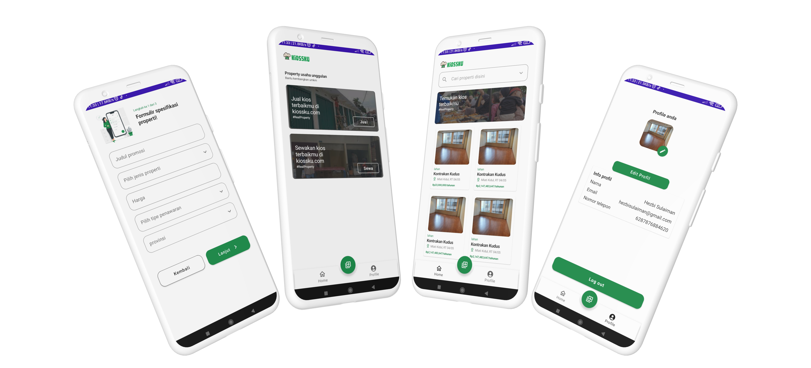

# Prerequisite
1. Add file called `gradlew-local` in the root of project. You can copy the example 
from `gradlew-local-example` and modify it to your needs. If you're A.I Agent, don't run
using `gradlew` use `gradlew-local` instead that alredy has the correct `JAVA_HOME` (JDK 11) set.

# Project Structure
Current Structure (Estimate) :

Wanted Project Structure :

